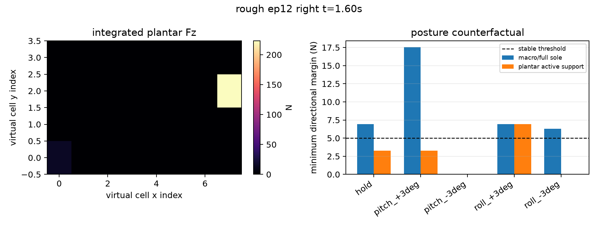
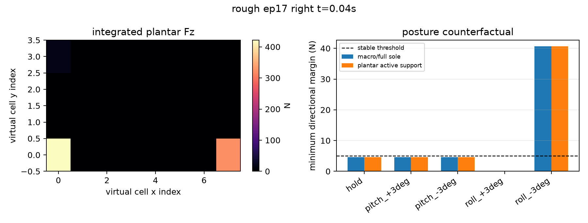

# 当前落脚点足部姿态修正：反事实示例

本报告是保存的G1离线计算记录；2026-10-25只核对说明，未重新运行计算或仿真。数据批次见 [连续足板入口](../../README.md)。本报告不修改行走控制器。对同一个已记录的落脚时刻，冻结法向载荷和踝部宏观力，只把足部俯仰/横滚改变 3 度（等效载荷线移动约 2.36 cm），比较原姿态和修正姿态。

## 如何读结果

- 宏观路径：只看踝部六维力/CoP，沿原定姿态继续。
- 增强路径：用有载荷阵列单元确定局部支撑边界，再用踝部 IMU 角速度标出是否需要立即处理；选择能使四个方向最小余量最大的俯仰/横滚修正。
- 离线阈值达标：假设修正后，模型计算的四个方向最小加载余量均不低于5 N；原JSON／图中的“成功”只指此判据。

这是一帧快照上的可复算几何反事实，没有执行姿态动作或重算其后的接触分布，也没有验证到达过程。宏观路径被设定为保持姿态，与增强路径的动作权限不同，不能据此完成公平控制收益归因；原回合fall标签也不能证明该帧低余量导致跌倒。它不是闭环控制或整机稳定性保证。

## 示例 1: rough episode 12 right t=1.60 s

- 该脚法向合力：238.1 N；活动阵列单元：2；踝部角速度范数：1.64 rad/s；原回合标签：**fall**。
- 宏观路径保持原姿态：当前最小余量 6.93 N，宏观观察者会 **继续保持**。
- 足底+IMU 路径建议 **roll_+3deg**：修正后最小余量 6.93 N，判定为 **离线阈值达标**。

| 姿态候选 | 宏观模型最小余量 (N) | 足底边界模型最小余量 (N) |
| --- | ---: | ---: |
| hold | 6.93 | 3.25 |
| pitch_+3deg | 17.54 | 3.25 |
| pitch_-3deg | 0.00 | 0.00 |
| roll_+3deg | 6.93 | 6.93 |
| roll_-3deg | 6.31 | 0.00 |

## 示例 2: rough episode 17 right t=0.04 s

- 该脚法向合力：764.0 N；活动阵列单元：3；踝部角速度范数：0.81 rad/s；原回合标签：**fall**。
- 宏观路径保持原姿态：当前最小余量 4.61 N，宏观观察者会 **看到余量不足但不改变原策略**。
- 足底+IMU 路径建议 **roll_-3deg**：修正后最小余量 40.64 N，判定为 **离线阈值达标**。

| 姿态候选 | 宏观模型最小余量 (N) | 足底边界模型最小余量 (N) |
| --- | ---: | ---: |
| hold | 4.61 | 4.61 |
| pitch_+3deg | 4.61 | 4.61 |
| pitch_-3deg | 4.61 | 4.61 |
| roll_+3deg | 0.00 | 0.00 |
| roll_-3deg | 40.64 | 40.64 |

